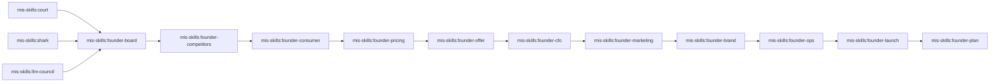
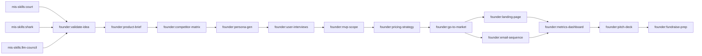
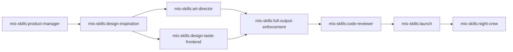
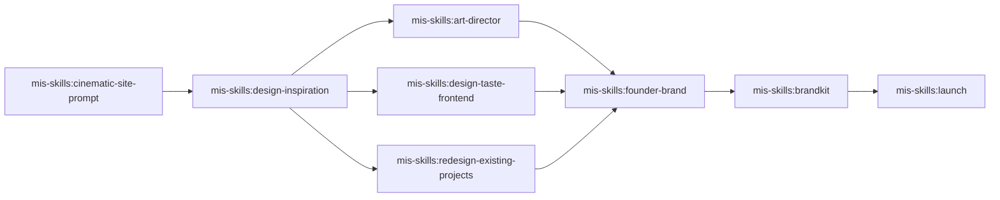
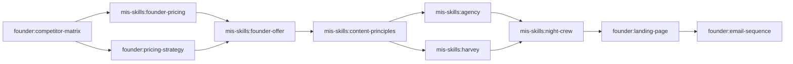
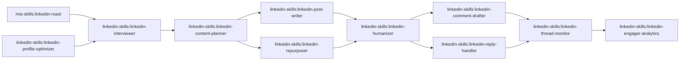
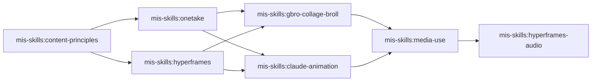

# Mapa de skills

Generado por `tools/skill-graph/build.py` desde los `SKILL.md` y `tools/skill-graph/curated.json`. No lo edites a mano.

88 skills, 48 archivos compartidos, 699 conexiones. El mismo grafo, para Graphicle: `graph.json`.

Relaciones: **lee** / **escribe** (archivos), **siguiente** (paso que sigue), **enruta a** (elige un flujo), **usa el script de**, **alternativa a**, **complementa**, **necesita**, **menciona**.

## Recetas

### Receta: de idea a negocio (local, servicio o producto físico)
1. `/mis-skills:court` o `/mis-skills:shark` o `/mis-skills:llm-council`
2. `/mis-skills:founder-board`
3. `/mis-skills:founder-competitors`
4. `/mis-skills:founder-consumer`
5. `/mis-skills:founder-pricing`
6. `/mis-skills:founder-offer`
7. `/mis-skills:founder-cfo`
8. `/mis-skills:founder-marketing`
9. `/mis-skills:founder-brand`
10. `/mis-skills:founder-ops`
11. `/mis-skills:founder-launch`
12. `/mis-skills:founder-plan`

Orden: Jakeschincariol/founder-skill README: board -> competitors -> consumer -> pricing -> offer -> cfo -> marketing -> brand -> ops -> launch -> plan

### Receta: de idea a startup de software (con ronda)
1. `/mis-skills:court` o `/mis-skills:shark` o `/mis-skills:llm-council`
2. `/founder:validate-idea`
3. `/founder:product-brief`
4. `/founder:competitor-matrix`
5. `/founder:persona-gen`
6. `/founder:user-interviews`
7. `/founder:mvp-scope`
8. `/founder:pricing-strategy`
9. `/founder:go-to-market`
10. `/founder:landing-page` o `/founder:email-sequence`
11. `/founder:metrics-dashboard`
12. `/founder:pitch-deck`
13. `/founder:fundraise-prep`

Orden: Order follows each skill's Reads line in plugins/founder

### Receta: de idea a producto publicado
1. `/mis-skills:product-manager`
2. `/mis-skills:design-inspiration`
3. `/mis-skills:art-director` o `/mis-skills:design-taste-frontend`
4. `/mis-skills:full-output-enforcement`
5. `/mis-skills:code-reviewer`
6. `/mis-skills:launch`
7. `/mis-skills:night-crew`

### Receta: web nueva o rediseño
1. `/mis-skills:cinematic-site-prompt`
2. `/mis-skills:design-inspiration`
3. `/mis-skills:art-director` o `/mis-skills:design-taste-frontend` o `/mis-skills:redesign-existing-projects`
4. `/mis-skills:founder-brand`
5. `/mis-skills:brandkit`
6. `/mis-skills:launch`

### Receta: conseguir clientes (QuitoWeb)
1. `/founder:competitor-matrix`
2. `/mis-skills:founder-pricing` o `/founder:pricing-strategy`
3. `/mis-skills:founder-offer`
4. `/mis-skills:content-principles`
5. `/mis-skills:agency` o `/mis-skills:harvey`
6. `/mis-skills:night-crew`
7. `/founder:landing-page`
8. `/founder:email-sequence`

### Receta: marca personal en LinkedIn
1. `/mis-skills:linkedin-roast` o `/linkedin-skills:linkedin-profile-optimizer`
2. `/linkedin-skills:linkedin-interviewer`
3. `/linkedin-skills:linkedin-content-planner`
4. `/linkedin-skills:linkedin-post-writer` o `/linkedin-skills:linkedin-repurposer`
5. `/linkedin-skills:linkedin-humanizer`
6. `/linkedin-skills:linkedin-comment-drafter` o `/linkedin-skills:linkedin-reply-handler`
7. `/linkedin-skills:linkedin-thread-monitor`
8. `/linkedin-skills:linkedin-engager-analytics`

### Receta: video corto
1. `/mis-skills:content-principles`
2. `/mis-skills:onetake` o `/mis-skills:hyperframes`
3. `/mis-skills:gbro-collage-broll` o `/mis-skills:claude-animation`
4. `/mis-skills:media-use`
5. `/mis-skills:hyperframes-audio`

### Receta: entender y arreglar un repo
1. `/mis-skills:graphicle`
2. `/mis-skills:code-reviewer`
3. `/mis-skills:launch`

## Archivos que comparten

| Archivo | Lo escriben | Lo leen |
|---|---|---|
| `founder/board/*` | `mis-skills:founder-board` | `mis-skills:founder-board` |
| `founder/board.md` | `mis-skills:founder-board` | `mis-skills:founder-cfo`, `mis-skills:founder-offer` |
| `founder/brand.md` | `mis-skills:founder-brand` | `mis-skills:founder-launch` |
| `founder/business-plan.md` | `mis-skills:founder-plan` | - |
| `founder/cfo.md` | `mis-skills:founder-cfo` | `mis-skills:founder-cfo` |
| `founder/cfo-sources.md` | `mis-skills:founder-cfo` | `mis-skills:founder-cfo` |
| `founder/competitor-matrix.md` | `founder:competitor-matrix` | `founder:fundraise-prep`, `founder:go-to-market`, `founder:landing-page`, `founder:pitch-deck`, `founder:pricing-strategy`, `founder:product-brief`, `founder:validate-idea` |
| `founder/competitors.csv` | `mis-skills:founder-competitors` | `mis-skills:founder-competitors` |
| `founder/competitors.md` | `mis-skills:founder-competitors` | `mis-skills:founder-brand`, `mis-skills:founder-consumer`, `mis-skills:founder-marketing`, `mis-skills:founder-pricing` |
| `founder/customer.json` | `mis-skills:founder-consumer` | `mis-skills:founder-consumer` |
| `founder/email-sequence.md` | `founder:email-sequence` | - |
| `founder/facts.md` | `founder:competitor-matrix`, `founder:email-sequence`, `founder:fundraise-prep`, `founder:go-to-market`, `founder:landing-page`, `founder:metrics-dashboard`, `founder:mvp-scope`, `founder:persona-gen`, `founder:pitch-deck`, `founder:pricing-strategy`, `founder:product-brief`, `founder:user-interviews`, `founder:validate-idea` | `founder:competitor-matrix`, `founder:email-sequence`, `founder:fundraise-prep`, `founder:go-to-market`, `founder:landing-page`, `founder:metrics-dashboard`, `founder:mvp-scope`, `founder:persona-gen`, `founder:pitch-deck`, `founder:pricing-strategy`, `founder:product-brief`, `founder:user-interviews`, `founder:validate-idea` |
| `founder/fundraise-prep.md` | `founder:fundraise-prep` | `founder:pitch-deck` |
| `founder/go-to-market.md` | `founder:go-to-market` | `founder:metrics-dashboard`, `founder:pitch-deck` |
| `founder/idea.md` | `mis-skills:founder-board` | `mis-skills:founder-board`, `mis-skills:founder-brand`, `mis-skills:founder-competitors`, `mis-skills:founder-offer`, `mis-skills:founder-ops` |
| `founder/landing-page.md` | `founder:landing-page` | - |
| `founder/launch.md` | `mis-skills:founder-launch` | - |
| `founder/marketing.md` | `mis-skills:founder-marketing` | `mis-skills:founder-brand`, `mis-skills:founder-launch`, `mis-skills:founder-marketing` |
| `founder/metrics-dashboard.md` | `founder:metrics-dashboard` | `founder:fundraise-prep`, `founder:pitch-deck` |
| `founder/mvp-scope.md` | `founder:mvp-scope` | `founder:email-sequence`, `founder:go-to-market`, `founder:metrics-dashboard`, `founder:pricing-strategy` |
| `founder/numbers.json` | `mis-skills:founder-cfo`, `mis-skills:founder-ops`, `mis-skills:founder-pricing` | `mis-skills:founder-cfo`, `mis-skills:founder-launch`, `mis-skills:founder-marketing`, `mis-skills:founder-offer`, `mis-skills:founder-ops`, `mis-skills:founder-plan`, `mis-skills:founder-pricing` |
| `founder/offer.md` | `mis-skills:founder-offer` | `mis-skills:founder-marketing`, `mis-skills:founder-ops` |
| `founder/one-pager.md` | `mis-skills:founder-plan` | - |
| `founder/ops.md` | `mis-skills:founder-ops` | `mis-skills:founder-launch` |
| `founder/panel/*` | `mis-skills:founder-consumer` | `mis-skills:founder-brand`, `mis-skills:founder-cfo`, `mis-skills:founder-consumer`, `mis-skills:founder-marketing`, `mis-skills:founder-offer`, `mis-skills:founder-plan`, `mis-skills:founder-pricing` |
| `founder/persona-gen.md` | `founder:persona-gen` | `founder:email-sequence`, `founder:go-to-market`, `founder:landing-page`, `founder:mvp-scope`, `founder:pricing-strategy`, `founder:product-brief`, `founder:user-interviews` |
| `founder/pitch-deck.md` | `founder:pitch-deck` | `founder:fundraise-prep` |
| `founder/pitch.md` | `mis-skills:founder-brand`, `mis-skills:founder-consumer`, `mis-skills:founder-offer` | `mis-skills:founder-cfo`, `mis-skills:founder-consumer`, `mis-skills:founder-offer` |
| `founder/pitch-v1.md` | - | `mis-skills:founder-offer` |
| `founder/pricing-curve.md` | `mis-skills:founder-pricing` | - |
| `founder/pricing.md` | `mis-skills:founder-pricing` | `mis-skills:founder-cfo`, `mis-skills:founder-marketing` |
| `founder/pricing-strategy.md` | `founder:pricing-strategy` | `founder:email-sequence`, `founder:go-to-market`, `founder:landing-page`, `founder:metrics-dashboard`, `founder:pitch-deck` |
| `founder/product-brief.md` | `founder:product-brief` | `founder:competitor-matrix`, `founder:email-sequence`, `founder:fundraise-prep`, `founder:go-to-market`, `founder:landing-page`, `founder:metrics-dashboard`, `founder:mvp-scope`, `founder:persona-gen`, `founder:pitch-deck`, `founder:pricing-strategy`, `founder:user-interviews`, `founder:validate-idea` |
| `founder/summary.md` | `mis-skills:founder-plan` | - |
| `founder/user-interviews.md` | `founder:user-interviews` | `founder:persona-gen` |
| `founder/validate-idea.md` | `founder:validate-idea` | `founder:mvp-scope`, `founder:product-brief`, `founder:user-interviews` |
| `.graphicle/*` | `mis-skills:graphicle` | - |
| `~/harvey` | `mis-skills:harvey` | - |
| `linkedin-skills/references/algorithm-heuristics.md` | - | `linkedin-skills:linkedin-post-writer`, `linkedin-skills:linkedin-reply-handler`, `linkedin-skills:linkedin-repurposer` |
| `linkedin-skills/references/founder-topics.md` | - | `linkedin-skills:linkedin-content-planner`, `linkedin-skills:linkedin-post-writer` |
| `linkedin-skills/references/hook-formulas.md` | `linkedin-skills:linkedin-content-planner` | `linkedin-skills:linkedin-hook-extractor`, `linkedin-skills:linkedin-post-writer`, `linkedin-skills:linkedin-repurposer` |
| `linkedin-skills/references/story-bank.md` | `linkedin-skills:linkedin-interviewer` | `linkedin-skills:linkedin-comment-drafter`, `linkedin-skills:linkedin-content-planner`, `linkedin-skills:linkedin-interviewer`, `linkedin-skills:linkedin-post-writer`, `linkedin-skills:linkedin-reply-handler`, `linkedin-skills:linkedin-repurposer` |
| `linkedin-skills/references/untrusted-content.md` | - | `linkedin-skills:linkedin-comment-drafter`, `linkedin-skills:linkedin-engager-analytics`, `linkedin-skills:linkedin-hook-extractor`, `linkedin-skills:linkedin-interviewer`, `linkedin-skills:linkedin-reply-handler`, `linkedin-skills:linkedin-thread-monitor` |
| `linkedin-skills/references/voice-profile.md` | `linkedin-skills:linkedin-humanizer` | `linkedin-skills:linkedin-comment-drafter`, `linkedin-skills:linkedin-content-planner`, `linkedin-skills:linkedin-humanizer`, `linkedin-skills:linkedin-interviewer`, `linkedin-skills:linkedin-post-writer`, `linkedin-skills:linkedin-reply-handler`, `linkedin-skills:linkedin-repurposer` |
| `linkedin-skills/references/voice-rules.md` | - | `linkedin-skills:linkedin-comment-drafter` |
| `.mcp.json` | `mis-skills:graphicle` | - |
| `NIGHT-CREW.md` | `mis-skills:night-crew` | - |
| `<sitio>-cinematic-prompt.md` | `mis-skills:cinematic-site-prompt` | - |

## Requisitos

Detectados por palabra clave en cada SKILL.md (enlaces INFERRED): confírmalos en la skill antes de pedirle algo al usuario.

| Necesita | Skills |
|---|---|
| Clave de Apify | `linkedin-skills:linkedin-comment-drafter`, `linkedin-skills:linkedin-engager-analytics`, `linkedin-skills:linkedin-hook-extractor`, `linkedin-skills:linkedin-humanizer`, `linkedin-skills:linkedin-interviewer`, `linkedin-skills:linkedin-profile-optimizer`, `linkedin-skills:linkedin-reply-handler`, `linkedin-skills:linkedin-thread-monitor` |
| Chrome / Chromium | `mis-skills:claude-animation`, `mis-skills:design-taste-frontend`, `mis-skills:embedded-captions`, `mis-skills:find-skills`, `mis-skills:linkedin-roast`, `mis-skills:onetake` |
| Plan Claude Pro o Max | `mis-skills:harvey`, `mis-skills:night-crew` |
| ffmpeg | `mis-skills:claude-animation`, `mis-skills:embedded-captions`, `mis-skills:gbro-collage-broll`, `mis-skills:hyperframes-audio`, `mis-skills:hyperframes-cli`, `mis-skills:lemo-opuscar`, `mis-skills:motion-graphics`, `mis-skills:onetake`, `mis-skills:product-launch-video`, `mis-skills:talking-head-recut` |
| Clave de Gemini | `mis-skills:gbro-collage-broll`, `mis-skills:motion-graphics`, `mis-skills:product-launch-video` |
| Node.js | `mis-skills:claude-animation`, `mis-skills:embedded-captions`, `mis-skills:faceless-explainer`, `mis-skills:figma`, `mis-skills:find-skills`, `mis-skills:general-video`, `mis-skills:hyperframes`, `mis-skills:hyperframes-animation`, `mis-skills:hyperframes-audio`, `mis-skills:hyperframes-cli`, `mis-skills:hyperframes-core`, `mis-skills:hyperframes-keyframes`, `mis-skills:hyperframes-registry`, `mis-skills:lemo-opuscar`, `mis-skills:media-use`, `mis-skills:motion-director`, `mis-skills:motion-graphics`, `mis-skills:music-to-video`, `mis-skills:onetake`, `mis-skills:pr-to-video`, `mis-skills:product-launch-video`, `mis-skills:remotion-to-hyperframes`, `mis-skills:slideshow`, `mis-skills:talking-head-recut` |
| Clave de Pixfaro | `linkedin-skills:linkedin-post-writer` |
| Clave o conector de Publora | `linkedin-skills:linkedin-comment-drafter`, `linkedin-skills:linkedin-post-writer`, `linkedin-skills:linkedin-reply-handler`, `linkedin-skills:linkedin-repurposer` |
| Python 3 | `linkedin-skills:linkedin-humanizer`, `mis-skills:court`, `mis-skills:embedded-captions`, `mis-skills:founder-cfo`, `mis-skills:founder-consumer`, `mis-skills:founder-plan`, `mis-skills:founder-pricing`, `mis-skills:gbro-collage-broll`, `mis-skills:harvey`, `mis-skills:hyperframes-creative`, `mis-skills:launch`, `mis-skills:lemo-opuscar`, `mis-skills:linkedin-roast`, `mis-skills:music-to-video`, `mis-skills:onetake`, `mis-skills:shark` |

## Cada skill

### Plugin `mis-skills`

- **`/mis-skills:agency`** An AI automation agency that runs inside Claude Code: an outbound agent that writes personalized cold emails to a list of businesses, a sales agent that preps your calls and coaches you live from a call transcript, a wo…
  - siguiente: `mis-skills:night-crew`
  - viene después de: `mis-skills:content-principles`
  - alternativas: `mis-skills:harvey`
  - en: conseguir clientes (QuitoWeb)
- **`/mis-skills:art-director`** Art-directs web pages the way an editorial designer would, with real typographic scale contrast, a committed grid, one accent colour and one signature motion.
  - siguiente: `mis-skills:founder-brand`, `mis-skills:full-output-enforcement`
  - viene después de: `mis-skills:design-inspiration`
  - la complementan: `mis-skills:full-output-enforcement`, `mis-skills:high-end-visual-design`, `mis-skills:industrial-brutalist-ui`, `mis-skills:minimalist-ui`
  - alternativas: `mis-skills:design-taste-frontend`
  - en: de idea a producto publicado; web nueva o rediseño
- **`/mis-skills:brandkit`** Premium brand-kit image generation skill for creating high-end brand-guidelines boards, logo systems, identity decks, and visual-world presentations.
  - siguiente: `mis-skills:launch`
  - viene después de: `mis-skills:founder-brand`
  - la complementan: `mis-skills:founder-brand`
  - en: web nueva o rediseño
- **`/mis-skills:cinematic-site-prompt`** Writes a long, detailed build prompt (2,000-3,500 words) for a cinematic, scroll-driven website - a portfolio, personal site, studio or product page that plays like a short film - with art direction, a motion system, a…
  - escribe: `<sitio>-cinematic-prompt.md`
  - siguiente: `mis-skills:design-inspiration`
  - la complementan: `mis-skills:design-inspiration`
  - en: web nueva o rediseño
- **`/mis-skills:claude-animation`** Make a short hand-painted cartoon starring Clawd (the Claude mascot) or any character you design, written in p5.js and p5.brush and rendered locally to MP4.
  - siguiente: `mis-skills:media-use`
  - viene después de: `mis-skills:hyperframes`, `mis-skills:onetake`
  - necesita: `Chrome / Chromium`, `ffmpeg`, `Node.js`
  - alternativas: `mis-skills:hyperframes`, `mis-skills:lemo-opuscar`, `mis-skills:motion-director`, `mis-skills:onetake`
  - en: video corto
- **`/mis-skills:code-reviewer`** Audits a codebase along seven named dimensions, proves every finding against a concrete failing input before reporting it, then fixes the survivors one at a time with a verification step after each.
  - siguiente: `mis-skills:launch`
  - viene después de: `mis-skills:full-output-enforcement`, `mis-skills:graphicle`
  - la complementan: `mis-skills:graphicle`
  - en: de idea a producto publicado; entender y arreglar un repo
- **`/mis-skills:content-principles`** The psychology behind short-form content that holds attention.
  - siguiente: `mis-skills:agency`, `mis-skills:harvey`, `mis-skills:hyperframes`, `mis-skills:onetake`
  - viene después de: `mis-skills:founder-offer`
  - complementa: `linkedin-skills:linkedin-post-writer`, `mis-skills:founder-marketing`, `mis-skills:gbro-collage-broll`, `mis-skills:hyperframes`, `mis-skills:motion-director`, `mis-skills:onetake`
  - en: conseguir clientes (QuitoWeb); video corto
- **`/mis-skills:court`** Put an idea on trial in front of a jury of 12 Claudes.
  - siguiente: `founder:validate-idea`, `mis-skills:founder-board`
  - necesita: `Python 3`
  - alternativas: `mis-skills:llm-council`, `mis-skills:shark`
  - en: de idea a negocio (local, servicio o producto físico); de idea a startup de software (con ronda)
- **`/mis-skills:design-inspiration`** Points to the right free design inspiration galleries (from mkdir.directory) before designing a page, so the direction comes from real award-level sites instead of the default template.
  - siguiente: `mis-skills:art-director`, `mis-skills:design-taste-frontend`, `mis-skills:redesign-existing-projects`
  - viene después de: `mis-skills:cinematic-site-prompt`, `mis-skills:product-manager`
  - complementa: `mis-skills:cinematic-site-prompt`, `mis-skills:tactile-toy-prompt`
  - menciona: `mis-skills:art-director`, `mis-skills:design-taste-frontend`
  - en: de idea a producto publicado; web nueva o rediseño
- **`/mis-skills:design-taste-frontend`** tasteskill v2, the anti-slop frontend skill.
  - siguiente: `mis-skills:founder-brand`, `mis-skills:full-output-enforcement`
  - viene después de: `mis-skills:design-inspiration`
  - la complementan: `mis-skills:full-output-enforcement`, `mis-skills:high-end-visual-design`, `mis-skills:industrial-brutalist-ui`, `mis-skills:minimalist-ui`, `mis-skills:stitch-design-taste`
  - necesita: `Chrome / Chromium`
  - alternativas: `mis-skills:art-director`
  - en: de idea a producto publicado; web nueva o rediseño
- **`/mis-skills:embedded-captions`** Add captions or subtitles to an existing single-subject talking-head video without editing the footage.
  - necesita: `Chrome / Chromium`, `ffmpeg`, `Node.js`, `Python 3`
  - menciona: `mis-skills:hyperframes`
- **`/mis-skills:faceless-explainer`** Turn arbitrary text — an article, notes, a topic, a brief — into a faceless explainer video: there is no site or footage to capture, so the visuals are invented per scene (typography, abstract graphics, diagrams, data-v…
  - necesita: `Node.js`
  - menciona: `mis-skills:hyperframes`, `mis-skills:hyperframes-creative`, `mis-skills:media-use`, `mis-skills:product-launch-video`
- **`/mis-skills:figma`** Import Figma content into a HyperFrames composition — rendered assets, brand tokens, components, storyboard sections → reconstructed motion (frames read as states, not slides) (REST/CLI), connector-assisted motion when…
  - necesita: `Node.js`
- **`/mis-skills:find-skills`** Helps users discover and install agent skills when they ask questions like "how do I do X", "find a skill for X", "is there a skill that can...", or express interest in extending capabilities.
  - complementa: `mis-skills:skill-map`
  - necesita: `Chrome / Chromium`, `Node.js`
- **`/mis-skills:founder-board`** Your board of directors.
  - lee: `founder/board/*`, `founder/idea.md`
  - escribe: `founder/board/*`, `founder/board.md`, `founder/idea.md`
  - siguiente: `mis-skills:founder-competitors`, `mis-skills:founder-consumer`
  - viene después de: `mis-skills:court`, `mis-skills:llm-council`, `mis-skills:shark`
  - menciona: `mis-skills:founder-cfo`, `mis-skills:founder-competitors`, `mis-skills:founder-consumer`
  - alternativas: `founder:validate-idea`
  - en: de idea a negocio (local, servicio o producto físico)
- **`/mis-skills:founder-brand`** Your brand designer.
  - lee: `founder/competitors.md`, `founder/idea.md`, `founder/marketing.md`, `founder/panel/*`
  - escribe: `founder/brand.md`, `founder/pitch.md`
  - siguiente: `mis-skills:brandkit`, `mis-skills:founder-launch`, `mis-skills:founder-ops`
  - viene después de: `mis-skills:art-director`, `mis-skills:design-taste-frontend`, `mis-skills:founder-marketing`, `mis-skills:redesign-existing-projects`
  - complementa: `mis-skills:brandkit`
  - menciona: `mis-skills:founder-marketing`
  - en: de idea a negocio (local, servicio o producto físico); web nueva o rediseño
- **`/mis-skills:founder-cfo`** Your CFO.
  - lee: `founder/board.md`, `founder/cfo.md`, `founder/cfo-sources.md`, `founder/numbers.json`, `founder/panel/*`, `founder/pitch.md`, `founder/pricing.md`
  - escribe: `founder/cfo.md`, `founder/cfo-sources.md`, `founder/numbers.json`
  - siguiente: `mis-skills:founder-marketing`, `mis-skills:founder-plan`, `mis-skills:founder-pricing`
  - viene después de: `mis-skills:founder-offer`, `mis-skills:founder-pricing`
  - necesita: `Python 3`
  - en: de idea a negocio (local, servicio o producto físico)
- **`/mis-skills:founder-competitors`** Maps every competitor and the gap they leave.
  - lee: `founder/competitors.csv`, `founder/idea.md`
  - escribe: `founder/competitors.csv`, `founder/competitors.md`
  - siguiente: `mis-skills:founder-consumer`, `mis-skills:founder-pricing`
  - viene después de: `mis-skills:founder-board`
  - menciona: `mis-skills:founder-board`
  - alternativas: `founder:competitor-matrix`
  - en: de idea a negocio (local, servicio o producto físico)
- **`/mis-skills:founder-consumer`** The consumer panel.
  - lee: `founder/competitors.md`, `founder/customer.json`, `founder/panel/*`, `founder/pitch.md`
  - escribe: `founder/customer.json`, `founder/panel/*`, `founder/pitch.md`
  - siguiente: `mis-skills:founder-marketing`, `mis-skills:founder-offer`, `mis-skills:founder-pricing`
  - viene después de: `mis-skills:founder-board`, `mis-skills:founder-competitors`
  - necesita: `Python 3`
  - menciona: `mis-skills:founder-competitors`
  - en: de idea a negocio (local, servicio o producto físico)
- **`/mis-skills:founder-launch`** Your launch lead.
  - lee: `founder/brand.md`, `founder/marketing.md`, `founder/numbers.json`, `founder/ops.md`
  - escribe: `founder/launch.md`
  - siguiente: `mis-skills:founder-plan`
  - viene después de: `mis-skills:founder-brand`, `mis-skills:founder-marketing`, `mis-skills:founder-ops`
  - menciona: `mis-skills:founder-offer`, `mis-skills:founder-pricing`
  - en: de idea a negocio (local, servicio o producto físico)
- **`/mis-skills:founder-marketing`** Your marketing director.
  - lee: `founder/competitors.md`, `founder/marketing.md`, `founder/numbers.json`, `founder/offer.md`, `founder/panel/*`, `founder/pricing.md`
  - escribe: `founder/marketing.md`
  - siguiente: `mis-skills:founder-brand`, `mis-skills:founder-launch`
  - viene después de: `mis-skills:founder-cfo`, `mis-skills:founder-consumer`, `mis-skills:founder-offer`
  - la complementan: `mis-skills:content-principles`
  - alternativas: `founder:go-to-market`
  - en: de idea a negocio (local, servicio o producto físico)
- **`/mis-skills:founder-offer`** Builds an offer too good to refuse.
  - lee: `founder/board.md`, `founder/idea.md`, `founder/numbers.json`, `founder/panel/*`, `founder/pitch.md`, `founder/pitch-v1.md`
  - escribe: `founder/offer.md`, `founder/pitch.md`
  - siguiente: `mis-skills:content-principles`, `mis-skills:founder-cfo`, `mis-skills:founder-marketing`
  - viene después de: `founder:pricing-strategy`, `mis-skills:founder-consumer`, `mis-skills:founder-pricing`
  - la complementan: `mis-skills:llm-council`
  - menciona: `mis-skills:founder-consumer`
  - en: conseguir clientes (QuitoWeb); de idea a negocio (local, servicio o producto físico)
- **`/mis-skills:founder-ops`** Your operations manager.
  - lee: `founder/idea.md`, `founder/numbers.json`, `founder/offer.md`
  - escribe: `founder/numbers.json`, `founder/ops.md`
  - siguiente: `mis-skills:founder-launch`
  - viene después de: `mis-skills:founder-brand`
  - en: de idea a negocio (local, servicio o producto físico)
- **`/mis-skills:founder-plan`** Your business planner.
  - lee: `founder/numbers.json`, `founder/panel/*`
  - escribe: `founder/business-plan.md`, `founder/one-pager.md`, `founder/summary.md`
  - viene después de: `mis-skills:founder-cfo`, `mis-skills:founder-launch`
  - necesita: `Python 3`
  - menciona: `mis-skills:founder-cfo`
  - en: de idea a negocio (local, servicio o producto físico)
- **`/mis-skills:founder-pricing`** Finds the price buyers will actually pay.
  - lee: `founder/competitors.md`, `founder/numbers.json`, `founder/panel/*`
  - escribe: `founder/numbers.json`, `founder/pricing-curve.md`, `founder/pricing.md`
  - siguiente: `mis-skills:founder-cfo`, `mis-skills:founder-offer`
  - viene después de: `founder:competitor-matrix`, `mis-skills:founder-cfo`, `mis-skills:founder-competitors`, `mis-skills:founder-consumer`
  - usa el script de: `mis-skills:founder-cfo`
  - la complementan: `mis-skills:llm-council`
  - necesita: `Python 3`
  - menciona: `mis-skills:founder-consumer`
  - alternativas: `founder:pricing-strategy`
  - en: conseguir clientes (QuitoWeb); de idea a negocio (local, servicio o producto físico)
- **`/mis-skills:full-output-enforcement`** Overrides default LLM truncation behavior.
  - siguiente: `mis-skills:code-reviewer`
  - viene después de: `mis-skills:art-director`, `mis-skills:design-taste-frontend`
  - complementa: `mis-skills:art-director`, `mis-skills:design-taste-frontend`, `mis-skills:product-manager`, `mis-skills:redesign-existing-projects`
  - en: de idea a producto publicado
- **`/mis-skills:gbro-collage-broll`** 将约 5 秒口播文稿、观点句或抽象概念做成高级 editorial halftone paper-collage / 半调纸拼贴 B-roll。用户说“collage b-roll”“纸拼贴 b-roll”“半调拼贴”“拼贴风格配画面”“用这段文稿做拼贴动画”“gbro-collage-broll”，或希望把一句文稿转成拼贴视觉隐喻时，必须使用此 skill。强制采用三阶段审批：先只提视觉隐喻，用户确认后才生成彩色拼贴静帧，静帧再次确…
  - siguiente: `mis-skills:media-use`
  - viene después de: `mis-skills:hyperframes`, `mis-skills:onetake`
  - la complementan: `mis-skills:content-principles`
  - necesita: `ffmpeg`, `Clave de Gemini`, `Python 3`
  - en: video corto
- **`/mis-skills:general-video`** Author or edit a custom HyperFrames composition when no specialized workflow fits, or when BRIEF.md sets flow: companion.
  - necesita: `Node.js`
  - menciona: `mis-skills:figma`, `mis-skills:hyperframes`, `mis-skills:hyperframes-animation`, `mis-skills:hyperframes-audio`, `mis-skills:hyperframes-core`, `mis-skills:hyperframes-creative`, `mis-skills:hyperframes-keyframes`, `mis-skills:media-use`
- **`/mis-skills:graphicle`** Install and use Graphicle (github.com/graphicle-ai/graphicle), a local code graph and project memory for coding agents - it maps a repository into a graph of files, functions, calls and imports, remembers docs and decis…
  - escribe: `.graphicle/*`, `.mcp.json`
  - siguiente: `mis-skills:code-reviewer`
  - complementa: `mis-skills:code-reviewer`, `mis-skills:night-crew`
  - en: entender y arreglar un repo
- **`/mis-skills:harvey`** Install, set up and run Harvey (github.com/ethanplusai/harvey), an open-source autonomous sales agent that finds local businesses, learns something specific about each, writes cold email, sends it only after your approv…
  - escribe: `~/harvey`
  - siguiente: `mis-skills:night-crew`
  - viene después de: `mis-skills:content-principles`
  - necesita: `Plan Claude Pro o Max`, `Python 3`
  - alternativas: `mis-skills:agency`
  - en: conseguir clientes (QuitoWeb)
- **`/mis-skills:high-end-visual-design`** Teaches the AI to design like a high-end agency.
  - complementa: `mis-skills:art-director`, `mis-skills:design-taste-frontend`
  - alternativas: `mis-skills:industrial-brutalist-ui`, `mis-skills:minimalist-ui`
- **`/mis-skills:hyperframes`** Mandatory entry point: read this first for any request to make, create, edit, animate, or render a video, animation, or motion graphic, including a promo, explainer, captioned clip, title card, overlay, slideshow or int…
  - siguiente: `mis-skills:claude-animation`, `mis-skills:gbro-collage-broll`
  - viene después de: `mis-skills:content-principles`, `mis-skills:hyperframes-core`, `mis-skills:product-launch-video`
  - enruta a: `mis-skills:embedded-captions`, `mis-skills:faceless-explainer`, `mis-skills:general-video`, `mis-skills:motion-graphics`, `mis-skills:music-to-video`, `mis-skills:pr-to-video`, `mis-skills:product-launch-video`, `mis-skills:remotion-to-hyperframes`, `mis-skills:slideshow`, `mis-skills:talking-head-recut`
  - la complementan: `mis-skills:content-principles`
  - necesita: `Node.js`
  - menciona: `mis-skills:embedded-captions`, `mis-skills:faceless-explainer`, `mis-skills:figma`, `mis-skills:general-video`, `mis-skills:hyperframes-animation`, `mis-skills:hyperframes-audio`, `mis-skills:hyperframes-cli`, `mis-skills:hyperframes-core`, `mis-skills:hyperframes-creative`, `mis-skills:hyperframes-keyframes`, `mis-skills:hyperframes-registry`, `mis-skills:hyperframes-studio` …
  - alternativas: `mis-skills:lemo-opuscar`, `mis-skills:motion-director`, `mis-skills:onetake`, `mis-skills:claude-animation`
  - en: video corto
- **`/mis-skills:hyperframes-animation`** All animation knowledge for HyperFrames — atomic motion rules, multi-phase scene blueprints, scene transitions, broader motion-design techniques, AND the seven runtime adapters (GSAP default, plus Lottie, Three.js, Anim…
  - viene después de: `mis-skills:hyperframes-core`
  - necesita: `Node.js`
  - menciona: `mis-skills:hyperframes-cli`, `mis-skills:hyperframes-core`, `mis-skills:hyperframes-creative`
- **`/mis-skills:hyperframes-audio`** Use when audio already placed in a HyperFrames composition needs to be mixed: fade-in/fade-out, crossfade, track gain or volume, volume automation, ducking, a music bed that fights a voiceover (voiceover carve), effects…
  - viene después de: `mis-skills:media-use`
  - necesita: `ffmpeg`, `Node.js`
  - menciona: `mis-skills:hyperframes-core`, `mis-skills:media-use`
  - en: video corto
- **`/mis-skills:hyperframes-cli`** Use the HyperFrames CLI development loop: init, add, catalog, capture, lint, check, snapshot, compare, grade-compare, preview, play, present, beats, keyframes, single or batch render, publish, cloud, cloudrun, feedback,…
  - viene después de: `mis-skills:hyperframes-core`
  - necesita: `ffmpeg`, `Node.js`
  - menciona: `mis-skills:figma`, `mis-skills:hyperframes-animation`, `mis-skills:hyperframes-audio`, `mis-skills:hyperframes-core`, `mis-skills:hyperframes-keyframes`, `mis-skills:hyperframes-registry`, `mis-skills:media-use`, `mis-skills:slideshow`
- **`/mis-skills:hyperframes-core`** The HyperFrames composition contract — build one renderable project.
  - siguiente: `mis-skills:hyperframes`, `mis-skills:hyperframes-animation`, `mis-skills:hyperframes-cli`, `mis-skills:hyperframes-creative`, `mis-skills:hyperframes-registry`, `mis-skills:media-use`
  - necesita: `Node.js`
  - menciona: `mis-skills:hyperframes-animation`, `mis-skills:hyperframes-cli`
- **`/mis-skills:hyperframes-creative`** Non-animation creative direction for HyperFrames videos.
  - viene después de: `mis-skills:hyperframes-core`, `mis-skills:hyperframes-studio`
  - necesita: `Python 3`
  - menciona: `mis-skills:hyperframes-animation`, `mis-skills:hyperframes-core`
- **`/mis-skills:hyperframes-keyframes`** Use when a HyperFrames composition needs a punch-in, punch-out, zoom, reframe, Ken Burns treatment, camera move, visual match/whip handoff, or other seek-safe 2D/3D keyframes; also for GSAP, CSS keyframes, Anime.js, WAA…
  - necesita: `Node.js`
  - menciona: `mis-skills:hyperframes-animation`, `mis-skills:hyperframes-audio`, `mis-skills:hyperframes-cli`, `mis-skills:hyperframes-core`, `mis-skills:hyperframes-registry`
- **`/mis-skills:hyperframes-registry`** Search, install, and wire registry blocks and components into HyperFrames compositions.
  - viene después de: `mis-skills:hyperframes-core`
  - necesita: `Node.js`
  - menciona: `mis-skills:hyperframes-cli`
- **`/mis-skills:hyperframes-studio`** Use when working with a person on a HyperFrames project in Studio: first, whether their message asks for a change at all (questions, loose ideas and "don't change anything" get an answer and a plan, not an edit); for a…
  - siguiente: `mis-skills:hyperframes-creative`
  - menciona: `mis-skills:embedded-captions`, `mis-skills:hyperframes`, `mis-skills:hyperframes-core`, `mis-skills:hyperframes-creative`
- **`/mis-skills:industrial-brutalist-ui`** Raw mechanical interfaces fusing Swiss typographic print with military terminal aesthetics.
  - complementa: `mis-skills:art-director`, `mis-skills:design-taste-frontend`
  - alternativas: `mis-skills:minimalist-ui`, `mis-skills:high-end-visual-design`
- **`/mis-skills:launch`** Launch an app the way NASA launches a rocket: before it goes live, 8 Claude flight controllers each check one part of it (tests, security holes, the database, speed, the actual cost, the user's path, recovery, privacy a…
  - siguiente: `mis-skills:night-crew`
  - viene después de: `mis-skills:brandkit`, `mis-skills:code-reviewer`
  - necesita: `Python 3`
  - en: de idea a producto publicado; entender y arreglar un repo; web nueva o rediseño
- **`/mis-skills:lemo-opuscar`** Direct and produce a short film made entirely in code, in one of the styles of the Lemo-Opuscar library (e.g.
  - necesita: `ffmpeg`, `Node.js`, `Python 3`
  - alternativas: `mis-skills:motion-director`, `mis-skills:onetake`, `mis-skills:claude-animation`, `mis-skills:hyperframes`
- **`/mis-skills:linkedin-roast`** Roast a LinkedIn profile with five separate Claudes (a recruiter, a hiring manager, a founder, an expert in the owner's field and a peer), then fix it: a new headline, an About section with search keywords, every experi…
  - siguiente: `linkedin-skills:linkedin-interviewer`
  - necesita: `Chrome / Chromium`, `Python 3`
  - alternativas: `linkedin-skills:linkedin-profile-optimizer`
  - en: marca personal en LinkedIn
- **`/mis-skills:llm-council`** Run any question, idea, or decision through a council of 5 AI advisors who independently analyze it, peer-review each other anonymously, and synthesize a final verdict.
  - siguiente: `founder:validate-idea`, `mis-skills:founder-board`
  - complementa: `founder:pricing-strategy`, `mis-skills:founder-offer`, `mis-skills:founder-pricing`
  - alternativas: `mis-skills:shark`, `mis-skills:court`
  - en: de idea a negocio (local, servicio o producto físico); de idea a startup de software (con ronda)
- **`/mis-skills:media-use`** Agent Media OS for a HyperFrames project.
  - siguiente: `mis-skills:hyperframes-audio`
  - viene después de: `mis-skills:claude-animation`, `mis-skills:gbro-collage-broll`, `mis-skills:hyperframes-core`
  - necesita: `Node.js`
  - en: video corto
- **`/mis-skills:minimalist-ui`** Clean editorial-style interfaces.
  - complementa: `mis-skills:art-director`, `mis-skills:design-taste-frontend`
  - alternativas: `mis-skills:high-end-visual-design`, `mis-skills:industrial-brutalist-ui`
- **`/mis-skills:motion-director`** Make a short, high-impact video — a 10–20 second MP4 with an original soundtrack — from an idea, written entirely as a deterministic JavaScript film and rendered locally.
  - la complementan: `mis-skills:content-principles`
  - necesita: `Node.js`
  - alternativas: `mis-skills:onetake`, `mis-skills:claude-animation`, `mis-skills:hyperframes`, `mis-skills:lemo-opuscar`
- **`/mis-skills:motion-graphics`** A short, design-led motion graphic where motion is the message — kinetic typography, stat count-up, chart/data-viz hit, logo sting / brand lockup, lower-third / callout / social overlay, animated map (highlight regions,…
  - necesita: `ffmpeg`, `Clave de Gemini`, `Node.js`
  - menciona: `mis-skills:figma`, `mis-skills:general-video`, `mis-skills:hyperframes`, `mis-skills:hyperframes-animation`, `mis-skills:hyperframes-cli`, `mis-skills:media-use`
- **`/mis-skills:music-to-video`** Turn a music track (an audio file, a video to pull audio from, or a track generated from a mood brief) into a beat-synced video — lyric video, slideshow, or kinetic promo.
  - necesita: `Node.js`, `Python 3`
  - menciona: `mis-skills:hyperframes`, `mis-skills:media-use`
- **`/mis-skills:night-crew`** Set up a night crew for your app: three Claude Code cloud routines that work on your GitHub repo while you sleep.
  - escribe: `NIGHT-CREW.md`
  - siguiente: `founder:landing-page`
  - viene después de: `mis-skills:agency`, `mis-skills:harvey`, `mis-skills:launch`
  - la complementan: `mis-skills:graphicle`
  - necesita: `Plan Claude Pro o Max`
  - en: conseguir clientes (QuitoWeb); de idea a producto publicado
- **`/mis-skills:onetake`** Make short product / skill motion videos (10–30 s, narrated feature demos up to ~60 s) the way high-end launch clips are made — kinetic type, real UI as the material, a hand that causes every reaction, beats that carry…
  - siguiente: `mis-skills:claude-animation`, `mis-skills:gbro-collage-broll`
  - viene después de: `mis-skills:content-principles`
  - la complementan: `mis-skills:content-principles`
  - necesita: `Chrome / Chromium`, `ffmpeg`, `Node.js`, `Python 3`
  - alternativas: `mis-skills:claude-animation`, `mis-skills:hyperframes`, `mis-skills:lemo-opuscar`, `mis-skills:motion-director`
  - en: video corto
- **`/mis-skills:pr-to-video`** Turn a GitHub pull request (a PR URL, owner/repo#N, or 'this PR' in a checked-out repo) into a code-change explainer video — changelog, feature reveal, fix, or refactor walkthrough built from the diff, commits, and file…
  - necesita: `Node.js`
  - menciona: `mis-skills:faceless-explainer`, `mis-skills:hyperframes`, `mis-skills:hyperframes-creative`, `mis-skills:media-use`, `mis-skills:product-launch-video`
- **`/mis-skills:product-launch-video`** Turn a product or marketing URL, pasted script, or brief into a product launch / promo video — SaaS promos, feature reveals, product demos, app and company launches.
  - siguiente: `mis-skills:hyperframes`
  - necesita: `ffmpeg`, `Clave de Gemini`, `Node.js`
  - menciona: `mis-skills:figma`, `mis-skills:hyperframes`, `mis-skills:hyperframes-audio`, `mis-skills:hyperframes-creative`, `mis-skills:media-use`
- **`/mis-skills:product-manager`** Interview the user, write a product requirements document, then hold the build to it.
  - siguiente: `mis-skills:design-inspiration`
  - la complementan: `mis-skills:full-output-enforcement`
  - en: de idea a producto publicado
- **`/mis-skills:redesign-existing-projects`** Upgrades existing websites and apps to premium quality.
  - siguiente: `mis-skills:founder-brand`
  - viene después de: `mis-skills:design-inspiration`
  - la complementan: `mis-skills:full-output-enforcement`
  - en: web nueva o rediseño
- **`/mis-skills:remotion-to-hyperframes`** Port an existing Remotion (React) composition's source to HyperFrames HTML.
  - necesita: `Node.js`
  - menciona: `mis-skills:general-video`, `mis-skills:hyperframes`
- **`/mis-skills:shark`** Pitch your business idea to a Shark Tank-style panel of 5 Claude sharks who only want to say no.
  - siguiente: `founder:validate-idea`, `mis-skills:founder-board`
  - necesita: `Python 3`
  - alternativas: `mis-skills:court`, `mis-skills:llm-council`
  - en: de idea a negocio (local, servicio o producto físico); de idea a startup de software (con ronda)
- **`/mis-skills:skill-map`** The map of how every skill in the mis-skills, founder and linkedin-skills plugins connects - which files each one reads and writes, which runs next, which are alternatives, what each needs, and step-by-step recipes - as…
  - la complementan: `mis-skills:find-skills`
- **`/mis-skills:slideshow`** Author a HyperFrames slideshow — a presentation, pitch deck, or interactive deck with discrete slides, fragment reveals, branching, hotspot navigation, and built-in presenter mode with speaker notes; also converts an ex…
  - necesita: `Node.js`
  - menciona: `mis-skills:figma`, `mis-skills:hyperframes`, `mis-skills:hyperframes-core`
- **`/mis-skills:stitch-design-taste`** Semantic Design System Skill for Google Stitch.
  - complementa: `mis-skills:design-taste-frontend`
- **`/mis-skills:tactile-toy-prompt`** Turns a one-line idea for something squishy, stretchy, wobbly or pourable into a build prompt for a single-file three.js toy you can poke, pull, squash and throw, in the "Squishy Toast" / "Gummy Bears" format - the obje…
  - la complementan: `mis-skills:design-inspiration`
- **`/mis-skills:talking-head-recut`** Package an existing talking-head / interview / podcast video with timed, designed GRAPHIC OVERLAY cards — kinetic titles, lower-thirds, data callouts, quotes, side panels, picture-in-picture — synced to the transcript,…
  - necesita: `ffmpeg`, `Node.js`
  - menciona: `mis-skills:embedded-captions`, `mis-skills:faceless-explainer`, `mis-skills:hyperframes`, `mis-skills:pr-to-video`, `mis-skills:product-launch-video`

### Plugin `founder`

- **`/founder:competitor-matrix`** Research 5-8 real competitors and build a sourced feature comparison matrix, positioning gaps, threat ranking, and a niche to own.
  - lee: `founder/facts.md`, `founder/product-brief.md`
  - escribe: `founder/competitor-matrix.md`, `founder/facts.md`
  - siguiente: `founder:persona-gen`, `founder:pricing-strategy`, `mis-skills:founder-pricing`
  - viene después de: `founder:product-brief`
  - alternativas: `mis-skills:founder-competitors`
  - en: conseguir clientes (QuitoWeb); de idea a startup de software (con ronda)
- **`/founder:email-sequence`** Write a 5-7 email onboarding or re-engagement sequence with subject lines, A/B variants, send timing, and complete copy under 150 words per email.
  - lee: `founder/facts.md`, `founder/mvp-scope.md`, `founder/persona-gen.md`, `founder/pricing-strategy.md`, `founder/product-brief.md`
  - escribe: `founder/email-sequence.md`, `founder/facts.md`
  - siguiente: `founder:metrics-dashboard`
  - viene después de: `founder:go-to-market`, `founder:landing-page`
  - en: conseguir clientes (QuitoWeb); de idea a startup de software (con ronda)
- **`/founder:fundraise-prep`** Assess whether a startup is ready to raise, size the round and pick the instrument, build a 50-investor target list framework, and plan a 12-week raise.
  - lee: `founder/competitor-matrix.md`, `founder/facts.md`, `founder/metrics-dashboard.md`, `founder/pitch-deck.md`, `founder/product-brief.md`
  - escribe: `founder/facts.md`, `founder/fundraise-prep.md`
  - viene después de: `founder:pitch-deck`
  - en: de idea a startup de software (con ronda)
- **`/founder:go-to-market`** Plan a product launch from pre-launch audience building to a 90-day growth plan, with named communities, platform-specific launch tactics, channel rankings, and a budget for $0-$500 a month.
  - lee: `founder/competitor-matrix.md`, `founder/facts.md`, `founder/mvp-scope.md`, `founder/persona-gen.md`, `founder/pricing-strategy.md`, `founder/product-brief.md`
  - escribe: `founder/facts.md`, `founder/go-to-market.md`
  - siguiente: `founder:email-sequence`, `founder:landing-page`
  - viene después de: `founder:pricing-strategy`
  - menciona: `founder:landing-page`, `founder:metrics-dashboard`
  - alternativas: `mis-skills:founder-marketing`
  - en: de idea a startup de software (con ronda)
- **`/founder:landing-page`** Write landing page copy section by section, from hero to final call to action, including FAQ and SEO metadata.
  - lee: `founder/competitor-matrix.md`, `founder/facts.md`, `founder/persona-gen.md`, `founder/pricing-strategy.md`, `founder/product-brief.md`
  - escribe: `founder/facts.md`, `founder/landing-page.md`
  - siguiente: `founder:email-sequence`, `founder:metrics-dashboard`
  - viene después de: `founder:go-to-market`, `mis-skills:night-crew`
  - en: conseguir clientes (QuitoWeb); de idea a startup de software (con ronda)
- **`/founder:metrics-dashboard`** Pick the 5 metrics that matter at a startup's current stage, with definitions, targets, actions when below target, a minimal tracking setup, and a weekly review template.
  - lee: `founder/facts.md`, `founder/go-to-market.md`, `founder/mvp-scope.md`, `founder/pricing-strategy.md`, `founder/product-brief.md`
  - escribe: `founder/facts.md`, `founder/metrics-dashboard.md`
  - siguiente: `founder:pitch-deck`
  - viene después de: `founder:email-sequence`, `founder:landing-page`
  - en: de idea a startup de software (con ronda)
- **`/founder:mvp-scope`** Cut a feature wishlist down to the smallest MVP that delivers value.
  - lee: `founder/facts.md`, `founder/persona-gen.md`, `founder/product-brief.md`, `founder/validate-idea.md`
  - escribe: `founder/facts.md`, `founder/mvp-scope.md`
  - siguiente: `founder:pricing-strategy`
  - viene después de: `founder:user-interviews`
  - en: de idea a startup de software (con ronda)
- **`/founder:persona-gen`** Create 3 distinct user personas with a day in the life, quotable pain points, current workarounds, buying behavior, and a priority matrix showing who to build for first.
  - lee: `founder/facts.md`, `founder/product-brief.md`, `founder/user-interviews.md`
  - escribe: `founder/facts.md`, `founder/persona-gen.md`
  - siguiente: `founder:user-interviews`
  - viene después de: `founder:competitor-matrix`
  - en: de idea a startup de software (con ronda)
- **`/founder:pitch-deck`** Outline a 12-slide investor pitch deck with a takeaway headline, content, visual, and speaker notes for every slide, plus appendix slides for Q&A.
  - lee: `founder/competitor-matrix.md`, `founder/facts.md`, `founder/fundraise-prep.md`, `founder/go-to-market.md`, `founder/metrics-dashboard.md`, `founder/pricing-strategy.md`, `founder/product-brief.md`
  - escribe: `founder/facts.md`, `founder/pitch-deck.md`
  - siguiente: `founder:fundraise-prep`
  - viene después de: `founder:metrics-dashboard`
  - en: de idea a startup de software (con ronda)
- **`/founder:pricing-strategy`** Design pricing for a product.
  - lee: `founder/competitor-matrix.md`, `founder/facts.md`, `founder/mvp-scope.md`, `founder/persona-gen.md`, `founder/product-brief.md`
  - escribe: `founder/facts.md`, `founder/pricing-strategy.md`
  - siguiente: `founder:go-to-market`, `mis-skills:founder-offer`
  - viene después de: `founder:competitor-matrix`, `founder:mvp-scope`
  - la complementan: `mis-skills:llm-council`
  - alternativas: `mis-skills:founder-pricing`
  - en: conseguir clientes (QuitoWeb); de idea a startup de software (con ronda)
- **`/founder:product-brief`** Turn a one-sentence startup idea into a structured product brief with problem, audience, value proposition, 5-7 MVP features, 90-day metrics, risks, and a go-to-market snapshot.
  - lee: `founder/competitor-matrix.md`, `founder/facts.md`, `founder/persona-gen.md`, `founder/validate-idea.md`
  - escribe: `founder/facts.md`, `founder/product-brief.md`
  - siguiente: `founder:competitor-matrix`
  - viene después de: `founder:validate-idea`
  - menciona: `founder:persona-gen`
  - en: de idea a startup de software (con ronda)
- **`/founder:user-interviews`** Write a 25-minute customer discovery interview script that follows The Mom Test, with screening criteria, exact wording, red flags, and a framework for analyzing 5-8 interviews.
  - lee: `founder/facts.md`, `founder/persona-gen.md`, `founder/product-brief.md`, `founder/validate-idea.md`
  - escribe: `founder/facts.md`, `founder/user-interviews.md`
  - siguiente: `founder:mvp-scope`
  - viene después de: `founder:persona-gen`
  - en: de idea a startup de software (con ronda)
- **`/founder:validate-idea`** Stress-test a startup idea before any code is written.
  - lee: `founder/competitor-matrix.md`, `founder/facts.md`, `founder/product-brief.md`
  - escribe: `founder/facts.md`, `founder/validate-idea.md`
  - siguiente: `founder:product-brief`
  - viene después de: `mis-skills:court`, `mis-skills:llm-council`, `mis-skills:shark`
  - alternativas: `mis-skills:founder-board`
  - en: de idea a startup de software (con ronda)

### Plugin `linkedin-skills`

- **`/linkedin-skills:linkedin-comment-drafter`** Draft a LinkedIn comment on someone else's post from its URL, or reshare (repost) it to your feed with optional commentary.
  - lee: `linkedin-skills/references/story-bank.md`, `linkedin-skills/references/untrusted-content.md`, `linkedin-skills/references/voice-profile.md`, `linkedin-skills/references/voice-rules.md`
  - siguiente: `linkedin-skills:linkedin-thread-monitor`
  - viene después de: `linkedin-skills:linkedin-humanizer`
  - necesita: `Clave de Apify`, `Clave o conector de Publora`
  - menciona: `linkedin-skills:linkedin-employee-advocacy`, `linkedin-skills:linkedin-hook-extractor`, `linkedin-skills:linkedin-humanizer`, `linkedin-skills:linkedin-interviewer`, `linkedin-skills:linkedin-reply-handler`
  - en: marca personal en LinkedIn
- **`/linkedin-skills:linkedin-content-planner`** Generate a 7-day LinkedIn content plan from a theme, audience, and pillars.
  - lee: `linkedin-skills/references/founder-topics.md`, `linkedin-skills/references/story-bank.md`, `linkedin-skills/references/voice-profile.md`
  - escribe: `linkedin-skills/references/hook-formulas.md`
  - siguiente: `linkedin-skills:linkedin-post-writer`, `linkedin-skills:linkedin-repurposer`
  - viene después de: `linkedin-skills:linkedin-interviewer`
  - menciona: `linkedin-skills:linkedin-comment-drafter`, `linkedin-skills:linkedin-engager-analytics`, `linkedin-skills:linkedin-humanizer`, `linkedin-skills:linkedin-interviewer`, `linkedin-skills:linkedin-post-writer`, `linkedin-skills:linkedin-thread-monitor`
  - en: marca personal en LinkedIn
- **`/linkedin-skills:linkedin-employee-advocacy`** Stand up and run a LinkedIn employee advocacy program for a marketing or sales team.
  - menciona: `linkedin-skills:linkedin-comment-drafter`, `linkedin-skills:linkedin-content-planner`, `linkedin-skills:linkedin-engager-analytics`, `linkedin-skills:linkedin-post-writer`, `linkedin-skills:linkedin-profile-optimizer`, `linkedin-skills:linkedin-thread-monitor`
- **`/linkedin-skills:linkedin-engager-analytics`** Pull the people who liked or commented on any LinkedIn post and segment them by ICP fit (peer / aspirational / prospect / other).
  - lee: `linkedin-skills/references/untrusted-content.md`
  - viene después de: `linkedin-skills:linkedin-thread-monitor`
  - necesita: `Clave de Apify`
  - menciona: `linkedin-skills:linkedin-comment-drafter`, `linkedin-skills:linkedin-reply-handler`, `linkedin-skills:linkedin-thread-monitor`
  - en: marca personal en LinkedIn
- **`/linkedin-skills:linkedin-hook-extractor`** Reverse-engineer the hook formula from a viral LinkedIn post URL.
  - lee: `linkedin-skills/references/hook-formulas.md`, `linkedin-skills/references/untrusted-content.md`
  - necesita: `Clave de Apify`
  - menciona: `linkedin-skills:linkedin-humanizer`, `linkedin-skills:linkedin-post-writer`
- **`/linkedin-skills:linkedin-humanizer`** Remove AI tells from LinkedIn posts/comments: 2026 vocabulary density, reveal bridges, staccato fragments, stacked triads, performed sincerity.
  - lee: `linkedin-skills/references/voice-profile.md`
  - escribe: `linkedin-skills/references/voice-profile.md`
  - siguiente: `linkedin-skills:linkedin-comment-drafter`, `linkedin-skills:linkedin-reply-handler`
  - viene después de: `linkedin-skills:linkedin-post-writer`, `linkedin-skills:linkedin-repurposer`
  - necesita: `Clave de Apify`, `Python 3`
  - menciona: `linkedin-skills:linkedin-post-writer`
  - en: marca personal en LinkedIn
- **`/linkedin-skills:linkedin-interviewer`** Interview the user for the raw material their posts are made of.
  - lee: `linkedin-skills/references/story-bank.md`, `linkedin-skills/references/untrusted-content.md`, `linkedin-skills/references/voice-profile.md`
  - escribe: `linkedin-skills/references/story-bank.md`
  - siguiente: `linkedin-skills:linkedin-content-planner`
  - viene después de: `linkedin-skills:linkedin-profile-optimizer`, `mis-skills:linkedin-roast`
  - necesita: `Clave de Apify`
  - menciona: `linkedin-skills:linkedin-content-planner`, `linkedin-skills:linkedin-humanizer`, `linkedin-skills:linkedin-post-writer`
  - en: marca personal en LinkedIn
- **`/linkedin-skills:linkedin-post-writer`** Draft a new LinkedIn post from scratch using one of 20 2026 hook formulas (anaphora, R.I.P., time-anchor, curiosity-gap, contrarian, controlled A/B, false-binary, and more) plus a founders-edition angle library, picked…
  - lee: `linkedin-skills/references/algorithm-heuristics.md`, `linkedin-skills/references/founder-topics.md`, `linkedin-skills/references/hook-formulas.md`, `linkedin-skills/references/story-bank.md`, `linkedin-skills/references/voice-profile.md`
  - siguiente: `linkedin-skills:linkedin-humanizer`
  - viene después de: `linkedin-skills:linkedin-content-planner`
  - la complementan: `mis-skills:content-principles`
  - necesita: `Clave de Pixfaro`, `Clave o conector de Publora`
  - menciona: `linkedin-skills:linkedin-hook-extractor`, `linkedin-skills:linkedin-humanizer`, `linkedin-skills:linkedin-interviewer`
  - en: marca personal en LinkedIn
- **`/linkedin-skills:linkedin-profile-optimizer`** Audit and rewrite a LinkedIn profile end-to-end for 2026: headline, About 7-step, Featured, banner, photo, Experience metrics, Skills, custom URL, recommendations.
  - siguiente: `linkedin-skills:linkedin-interviewer`
  - necesita: `Clave de Apify`
  - menciona: `linkedin-skills:linkedin-content-planner`, `linkedin-skills:linkedin-humanizer`, `linkedin-skills:linkedin-post-writer`
  - alternativas: `mis-skills:linkedin-roast`
  - en: marca personal en LinkedIn
- **`/linkedin-skills:linkedin-reply-handler`** Draft a reply to one LinkedIn comment from its URL, or sweep a whole thread from just the post URL and draft a reply to every comment worth answering, in one batch.
  - lee: `linkedin-skills/references/algorithm-heuristics.md`, `linkedin-skills/references/story-bank.md`, `linkedin-skills/references/untrusted-content.md`, `linkedin-skills/references/voice-profile.md`
  - siguiente: `linkedin-skills:linkedin-thread-monitor`
  - viene después de: `linkedin-skills:linkedin-humanizer`
  - necesita: `Clave de Apify`, `Clave o conector de Publora`
  - menciona: `linkedin-skills:linkedin-comment-drafter`, `linkedin-skills:linkedin-engager-analytics`, `linkedin-skills:linkedin-humanizer`, `linkedin-skills:linkedin-interviewer`, `linkedin-skills:linkedin-thread-monitor`
  - en: marca personal en LinkedIn
- **`/linkedin-skills:linkedin-repurposer`** Repurpose existing content into a native LinkedIn post.
  - lee: `linkedin-skills/references/algorithm-heuristics.md`, `linkedin-skills/references/hook-formulas.md`, `linkedin-skills/references/story-bank.md`, `linkedin-skills/references/voice-profile.md`
  - siguiente: `linkedin-skills:linkedin-humanizer`
  - viene después de: `linkedin-skills:linkedin-content-planner`
  - necesita: `Clave o conector de Publora`
  - menciona: `linkedin-skills:linkedin-hook-extractor`, `linkedin-skills:linkedin-humanizer`, `linkedin-skills:linkedin-interviewer`, `linkedin-skills:linkedin-post-writer`
  - en: marca personal en LinkedIn
- **`/linkedin-skills:linkedin-thread-monitor`** Track which of your LinkedIn comments earned author replies.
  - lee: `linkedin-skills/references/untrusted-content.md`
  - siguiente: `linkedin-skills:linkedin-engager-analytics`
  - viene después de: `linkedin-skills:linkedin-comment-drafter`, `linkedin-skills:linkedin-reply-handler`
  - necesita: `Clave de Apify`
  - menciona: `linkedin-skills:linkedin-comment-drafter`, `linkedin-skills:linkedin-engager-analytics`, `linkedin-skills:linkedin-reply-handler`
  - en: marca personal en LinkedIn
